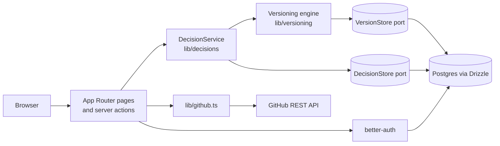

# core: architecture

How core is built: the pages and server actions over two engines, the data model, what leaves the
server, the lifecycle, drafts and drift checks, the demo deployment, and how it is tested.



## Contents

- [Overview](#overview)
- [Data model](#data-model)
- [Boundaries and security](#boundaries-and-security)
- [The lifecycle](#the-lifecycle)
- [Drafts](#drafts)
- [Code references and drift](#code-references-and-drift)
- [Deployment](#deployment)
- [Testing and CI](#testing-and-ci)
- [Platform and stack](#platform-and-stack)
- [Known trade-offs](#known-trade-offs)

## Overview

Next.js App Router pages and server actions over two engines in `lib/`, each written against a
storage interface with an in-memory and a Postgres implementation.

```text
lib/versioning/        document history, independent of decisions
  diff.ts                structural JSON diff over RFC 6901 pointers
  engine.ts              snapshot, commit, restore and history over a VersionStore
  memory-store.ts        in-memory VersionStore
  drizzle-store.ts       Postgres VersionStore

lib/decisions/         the decision domain
  types.ts, store.ts     records and the DecisionStore port (32 methods)
  lifecycle.ts           transitions as a data table, gated by capability
  service.ts             DecisionService: lifecycle, versioning and the store together
  lineage.ts             the supersession chain in both directions
  snippet.ts             comparing a cited line range, and finding it if it moved
  citation.ts            the {{owner/repo:path#lines}} token
  drift.ts               a reference's status relative to its baseline
  key.ts                 workspace keys and ADR labels (HAU-001)
  retry.ts               retrying the ADR-number insert after a unique violation
  form.ts, draft-label.ts  reading form data; naming an untitled draft
  seeded-draft.ts        the demo's seeded draft and its nightly restore
  memory-store.ts        in-memory DecisionStore
  drizzle-store.ts       Postgres DecisionStore

lib/markdown/editing.ts  textarea editing: lists, indentation, wrapping
lib/db/                  Drizzle schema and client
lib/github.ts            repository trees, file contents, blob SHAs, token selection
app/app/actions.ts       server actions: authentication, demo refusals, GitHub calls
```

The interface is built on haus; [DESIGN § Design system](DESIGN.md#design-system) covers which
components and tokens core takes and what it keeps.

## Data model

| Table                                        | Holds                                                                                                                           |
| -------------------------------------------- | ------------------------------------------------------------------------------------------------------------------------------- |
| `workspaces`                                 | Name and key (`HAU`)                                                                                                            |
| `memberships`                                | User, workspace, role (`author` or `maintainer`)                                                                                |
| `decisions`                                  | Workspace, number, title, status, author, `supersededById`, the versioned document's id. Unique on workspace and number         |
| `decision_transitions`                       | From, to, actor, time, reason. Append-only                                                                                      |
| `decision_references`                        | File or link references: label, URL, repository, path, line range, cited text, baseline and current blob SHA, when last checked |
| `decision_drafts`                            | Author, workspace, title, body, cited references. No number                                                                     |
| `workspace_repos`                            | Connected repositories. Unique on workspace, owner and name                                                                     |
| `documents`, `document_versions`             | The versioning engine's documents and commits                                                                                   |
| `user`, `session`, `account`, `verification` | better-auth. `account` holds linked GitHub tokens                                                                               |

### Storage ports

**Decision.** `DecisionService` and `Versioning` depend on store interfaces, with a memory and a
Drizzle implementation of each. Two writes that must succeed or fail together are each one store
method, which the Drizzle store wraps in a transaction: creating a decision with its opening
transition, and changing a status with its transition row.

**Reason.** Domain tests run real service code against the memory store, and the pairs cannot be
left half written.

## Boundaries and security

Authentication is better-auth, with email and password and optional GitHub linking. Every server
action calls `requireUser` before anything else, the actions that change the log also refuse the
demo account, and lifecycle actions are gated by capability (see [The lifecycle](#the-lifecycle)).

Outbound requests go to GitHub only: the REST API from `lib/github.ts` (repository trees, file
contents and blob SHAs), and better-auth's OAuth exchange when GitHub linking is on.

### Server action errors

**Decision.** Every failure the file picker can meet (not a member, GitHub off, no linked account,
no connected repositories, GitHub unreachable) is returned as a message, not thrown.

**Reason.** React reports a server action that throws as error #441, with the message removed in
production builds.

**Alternatives.** Two earlier fixes changed the wrong throw before this was found.

### GitHub tokens

**Decision.** `getReadToken` uses the signed-in person's linked account when there is one, and
`GITHUB_PUBLIC_TOKEN` otherwise: a token of the deployment owner's, read-only and limited to public
repositories. The repository picker lists repositories with the person's own account, so it needs a
linked one; `connectRepo` stores the repository it is given. Repository trees are cached per server
instance for five minutes.

**Reason.** A linked account can reach private repositories. Listing repositories with the
deployment's token in the picker would show the owner's repositories to whoever is signed in. The file picker
requests every connected repository's tree on each mount, and without the cache a few visitors
would use up the hourly GitHub API allowance.

## The lifecycle

The four transitions are rows in a table in `lib/decisions/lifecycle.ts`, each gated by a
capability; roles are lists of capabilities. [FEATURE § The lifecycle](FEATURE.md#the-lifecycle)
shows the states and the role table.

### Lifecycle guards

**Decision.** Every lifecycle check returns `{ ok: true }` or `{ ok: false, reason }`, for example
"requires the accept capability" or "a decision is immutable once it leaves 'proposed'".

**Reason.** The interface can tell a missing permission from a decision that has already moved on.

### Immutability after acceptance

**Decision.** `canEditContent` refuses any decision not in `proposed`. To change an accepted
decision, a new one is accepted and supersedes it.

**Reason.** The accepted text stays as it was agreed.

### Audit trails

**Decision.** Text revisions are commits in the versioning engine. Status changes are rows in the
append-only `decision_transitions` table.

**Reason.** One asks how the text changed, the other when and by whom the decision moved, and a
single timeline would mix edits with approvals.

### Restoring a version

**Decision.** Restoring a version writes a new commit whose content equals that version. The commits
made after it stay in the history; their changes are not in the restored document.

**Reason.** The restore leaves a record, and nothing committed after the restored version is lost
from the history.

**Alternatives.** Moving the head back. It removes commits, so a restore would erase work committed
after the restored version and leave no record of itself.

## Drafts

### Draft storage

**Decision.** A draft is stored in `decision_drafts`, not `decisions`. It has no ADR number, no
transitions and no required title (a missing title is derived from the first line written,
preferring the Decision section, in `draft-label.ts`). It is private to its author, maintainers
included, and not versioned. A draft is capped at 128KB and an author at 20 drafts per workspace.

**Reason.** A number reserved for a draft that is then abandoned leaves a gap in the sequence, and
people cite decisions by number. Every decision is visible to the workspace; a draft has no readers
yet, so it has no history for the team. `saveDraft` is available to any member, so drafts are
bounded.

### Local autosave and server drafts

**Decision.** `localStorage` holds a compose session that has not reached the server. A server draft
is saved on purpose and appears in the decisions list. Once a server draft exists, local autosave
stops.

**Reason.** The local copy covers a crashed browser or a closed tab. Once a server draft exists, the
list is where it will be found.

## Code references and drift

A reference to a file records its blob SHA and, for a line range, the text of those lines. A check
reports whether the cited lines changed, moved or disappeared.

### Line ranges

**Decision.** A reference can cite a line range, not only a whole file.

**Reason.** A whole-file reference is marked changed by any commit to the file, including one to an
unrelated function, and the larger the file the more often that happens. A line range is marked
changed only when those lines change.

### Moved blocks

**Decision.** When the cited text is no longer at its lines, the file is searched for it before the
reference is marked drifted. Trailing whitespace is removed before comparing; leading indentation is
kept.

**Reason.** Twenty lines inserted above a block move it without changing it, and reformatting is not
a change. A block that changed indentation changed scope.

### Baselines

**Decision.** On acceptance, each reference's baseline moves to the code at that moment, following a
block that moved during review to its new lines. Re-baselining is best-effort: a GitHub failure does
not undo the acceptance.

**Reason.** A citation made while drafting records the code the author saw, and a proposal that sat
in review while its code changed should not be drifted the moment it is accepted. The acceptance is
already recorded when re-baselining runs.

### When drift is checked

**Decision.** Drift is not checked while composing or editing. The status is shown on the decision
page, and a re-check records each reference's current SHA.

**Reason.** A file cited seconds ago can only be in sync. The decision page is where someone decides
whether the decision needs revisiting.

### The citation token

**Decision.** A citation is the token `{{owner/repo:path#L47-L120}}`. Tokens become ordinary markdown
links before parsing, so react-markdown renders them with no plugin and its escaping applies. A token
that does not resolve renders as inline code.

**Reason.** The token can be typed, pasted and copied into a commit message or chat. An editor node
would not survive the copy.

## Deployment

[core.hipuku.dev](https://core.hipuku.dev) runs on Vercel with functions in `syd1`
(`regions` in `vercel.json`), against a Neon database in Sydney. A signed-in page load makes several
queries in sequence (session, membership, data), and with the functions in Vercel's default US
region each one crossed the Pacific.

### Demo restrictions

**Decision.** The public demo sets three switches:

- **`DISABLE_SIGNUP=1`.** `/sign-up` is a 404, and there is one seeded account.
- **The demo account (`DEMO_USER_EMAIL`) may not change the decision log.** It may save and discard
  drafts; fifteen actions refuse it (creating, editing and deleting workspaces, inviting and removing
  members, connecting and disconnecting repositories, adding and removing references, proposing,
  revising, changing status, superseding, re-checking drift). The refusal is in the action layer.
  Three actions that only read from GitHub need no refusal.
- **`DISABLE_GITHUB=1`.** Connect GitHub is hidden.

Every visitor signs in as that account, so its drafts are shared. `/api/cron/prune-drafts` runs
nightly (`vercel.json`), deletes its drafts not updated in 24 hours, then restores the seeded draft
if no draft with its title remains. The route requires `CRON_SECRET` as a bearer token and refuses
to run when the secret is unset where a demo account is configured.

**Reason.** The refusals belong to this deployment, not to what a decision log allows, so they sit in
the action layer rather than the domain. The OAuth flow requests the `repo` scope, which can write
to private repositories, and better-auth stores the token; on a public deployment that means holding
strangers' write tokens.

**Alternatives.** An invite code for sign-up. Whoever holds one can pass it on.

## Testing and CI

```bash
npm run lint && npm run typecheck && npm test
```

Vitest runs two projects. `domain` runs `lib/**/*.test.ts` in Node. `ui` runs the `.test.tsx`
suites in jsdom: draft autosave and recovery, the unsaved-changes guard, the compose editor's
keystrokes, the draft list, the modal shell, the confirmation dialog's failure path and a
Mermaid diagram's recovery. 345 tests in 25 files.

### Postgres store tests

**Decision.** Every domain test uses the memory store, and two suites check the Postgres store
against it. `store-parity.test.ts` checks that both stores implement the port's 32 methods, listed in
the test rather than read from either store. `store-contract.test.ts` runs 43 cases against both
stores with the same assertions. The Postgres side runs on PGlite, Postgres compiled to WebAssembly
and run in the test process, with tables created from the Drizzle schema by `test/pg.ts` on each run.

**Reason.** TypeScript does not object to a method one store has and the other lacks when the
interface lacks it too, which the parity suite's own list catches; it checks no behaviour. The contract suite catches the
rest, such as an order that only holds because a `Map` keeps insertion order, or a null stored
differently. PGlite behaves as Postgres for constraints, types and transactions with no Docker,
service container or `DATABASE_URL`.

**Alternatives.** PGlite behind a socket for the end-to-end suite. It accepts one connection at a
time, and Next.js with better-auth opens several, so that suite runs against a real Postgres.

`npm run e2e` runs four Playwright tests against a production build: sign-in, a decision's status
and history, keyboard access, and signed-out access. It pushes the schema and seeds whatever
`DATABASE_URL` points at, so that database must be disposable.

CI runs one job per check: `Lint` (ESLint, prose, CSS and the token-debt ratchet), `Format`,
`Typecheck`, `Test`, then `Build` and `End to end` against a Postgres service container.
[WORKFLOW.md](WORKFLOW.md) lists the checks the `main` ruleset requires.

## Platform and stack

### A textarea editor

**Decision.** The editor is a `<textarea>`. List continuation, Tab indentation and wrapping shortcuts
are functions from text and selection to text and selection, in `lib/markdown/editing.ts`, tested
without a DOM.

**Reason.** A rich editor would be a second rendering of the document to keep in step with the
markdown renderer.

**Alternatives.** CodeMirror and contenteditable.

## Known trade-offs

- **`app/app/actions.ts` has no tests of its own.** It holds `requireUser` and the demo refusals. Its
  pure helpers are tested where they moved: `lib/attempt.ts` and `lib/decisions/form.ts`.
  `snapshotFile`, `attachCitedFiles` and `rebaselineOnAccept` need GitHub and a store, and need
  fakes to test.
- **The seed's workspace is found by name.** Re-seeding deletes any workspace named `haus`, and the
  draft restore looks for one. A real workspace with that name on the same database would be
  replaced.
- **Email verification is off, and there is no rate limiting** beyond the draft limits. Neither
  matters while sign-up is closed. Both are needed before it opens.
