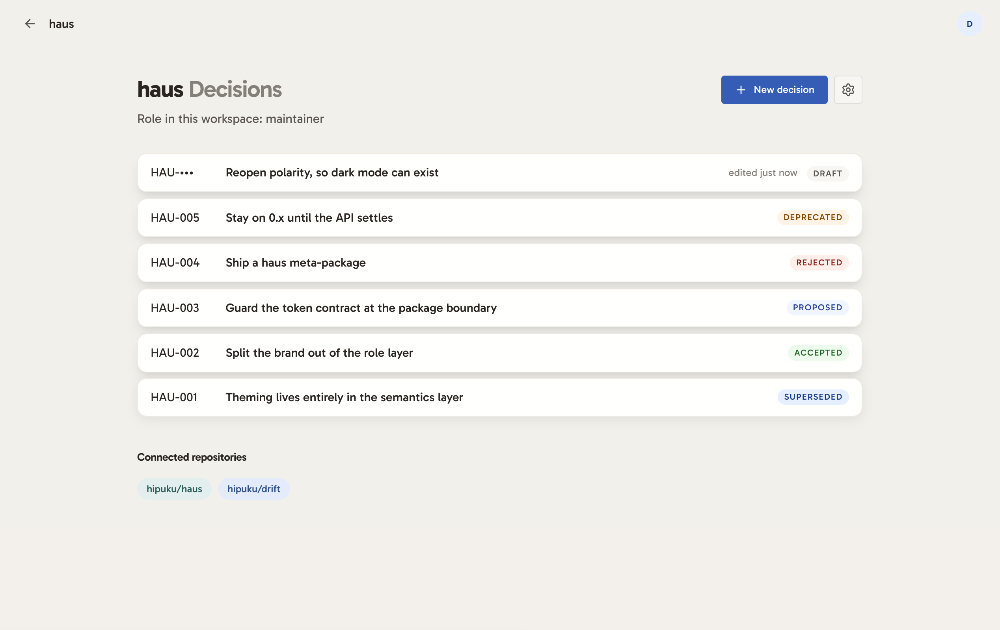

# core

A decision log for a team: architecture decision records with a permission-gated lifecycle, two
audit trails, and citations to lines of code in GitHub that are checked for changes. Next.js and
React over Postgres, with its interface built on the haus design system.



[](https://core.hipuku.dev)

The demo is read-only, with credentials on the sign-in page.

## At a glance

- **A lifecycle as data.** Transitions are rows in a table, each gated by a capability, and an
  accepted decision cannot be edited. [ARCHITECTURE § The lifecycle](ARCHITECTURE.md#the-lifecycle)
- **Two audit trails.** Text revisions are commits; status changes are append-only rows.
  [ARCHITECTURE § Audit trails](ARCHITECTURE.md#audit-trails)
- **Drift checks on cited code.** A cited line range is followed if it moves and reported if it
  changes. [ARCHITECTURE § Code references and drift](ARCHITECTURE.md#code-references-and-drift)
- **Built on haus.** Thirteen haus components and the `core` brand, with core keeping only what is
  about decisions. [DESIGN § Design system](DESIGN.md#design-system)
- **Storage is a port**, with a memory and a Postgres store held to one contract suite.
  [ARCHITECTURE § Postgres store tests](ARCHITECTURE.md#postgres-store-tests)
- **A public demo** with sign-up and GitHub linking switched off. Visitors can save drafts but
  cannot change the decision log.
  [ARCHITECTURE § Demo restrictions](ARCHITECTURE.md#demo-restrictions)

## Documentation

| File                                   | Covers                                                           |
| -------------------------------------- | ---------------------------------------------------------------- |
| [`FEATURE.md`](./FEATURE.md)           | Every screen and what it does                                    |
| [`DESIGN.md`](./DESIGN.md)             | Visual language, interaction and how core is built on haus       |
| [`ARCHITECTURE.md`](./ARCHITECTURE.md) | Engines, data, security, drift checks, deployment and testing    |
| [`WORKFLOW.md`](./WORKFLOW.md)         | Branches, pull requests, the checks that gate them, and releases |

## Install

Node 22.13 or later on 22, or 24 and later (`engines`); `.nvmrc` pins 22.

```bash
cp .env.example .env.local
```

```bash
npm install
```

```bash
npm run db:push
```

```bash
npm run dev
```

`.env.local` needs `DATABASE_URL` and `BETTER_AUTH_SECRET` (`openssl rand -base64 32`). A Neon or
Supabase free-tier Postgres works for development. Nothing else is required: no Redis, queue or
third-party service.

## Develop

**Seed data.**

```bash
npm run db:seed
```

This creates a workspace called `haus` with five decisions: one accepted then superseded, one
accepted, one proposed and revised, one rejected, one accepted then deprecated. They include
Mermaid, inline citations, seven references (one already drifted) and a draft. Re-running replaces
the `haus` workspace and removes the older `Vault` one, and touches nothing else.

**GitHub.** Connecting repositories needs a GitHub OAuth app: set `GITHUB_CLIENT_ID` and
`GITHUB_CLIENT_SECRET`, with the callback `<BETTER_AUTH_URL>/api/auth/callback/github`, and set
`BETTER_AUTH_URL` to the port the app runs on. Browsing and citing files uses the signed-in person's
linked account, or `GITHUB_PUBLIC_TOKEN` (a read-only token for public repositories) when there is
none. Without any of these, email and password sign-in and everything except files and repositories
work.

**The public demo's configuration.** To reproduce it, add to `.env.local`:

```bash
DISABLE_SIGNUP=1
DEMO_USER_EMAIL=demo@core.hipuku.dev
DEMO_USER_PASSWORD=read-only-demo-2026
DISABLE_GITHUB=1
```

`DISABLE_SIGNUP` makes `/sign-up` a 404 and removes its link. `DEMO_USER_*` names the account
`db:seed` creates. `DISABLE_GITHUB` hides Connect GitHub.

**Tests.** The `Lint`, `Typecheck` and `Test` jobs run `lint`, `lint:prose`, `lint:css`,
`lint:tokens`, `lint:md`, `typecheck` and `test` from the table below; `npm run e2e` needs a disposable
database. [ARCHITECTURE § Testing and CI](ARCHITECTURE.md#testing-and-ci)

## Scripts

| Script                 | What it does                                                              |
| ---------------------- | ------------------------------------------------------------------------- |
| `npm run dev`          | Next dev server                                                           |
| `npm run build`        | Production build                                                          |
| `npm run start`        | Serve the production build                                                |
| `npm run lint`         | ESLint                                                                    |
| `npm run lint:prose`   | Fails on a new em dash in a tracked file                                  |
| `npm run lint:md`      | markdownlint on the Markdown files `.markdownlint-cli2.jsonc` selects     |
| `npm run lint:css`     | Stylelint, including the hardcoded-value rule                             |
| `npm run lint:tokens`  | Fails when the count of hardcoded declarations changes without its record |
| `npm run format`       | Prettier, writing                                                         |
| `npm run format:check` | Prettier, checking only                                                   |
| `npm run typecheck`    | `tsc --noEmit`                                                            |
| `npm test`             | Vitest, both projects                                                     |
| `npm run e2e`          | Playwright, against a disposable database                                 |
| `npm run db:generate`  | Generate a Drizzle migration                                              |
| `npm run db:push`      | Push the Drizzle schema to the database                                   |
| `npm run db:seed`      | Create the seeded `haus` workspace                                        |
| `npm run db:studio`    | Drizzle Studio                                                            |

## Stack

Next.js (App Router) · React · TypeScript · Postgres · Drizzle ORM · better-auth · haus
(`haus-tokens`, `haus-components`) · CSS Modules · Vitest · Playwright
